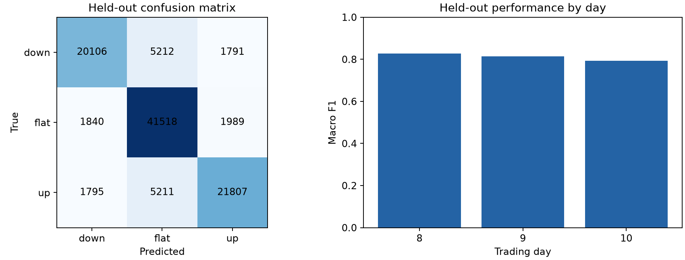
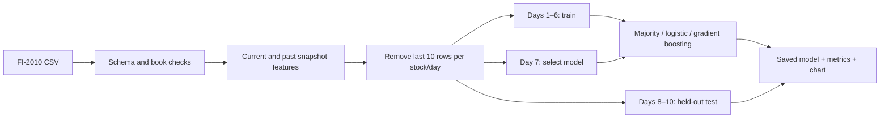

# FI-2010 Limit Order Book ML

An end-to-end, reproducible machine learning benchmark for short-horizon mid-price direction classification. Built as a portfolio project for financial machine learning engineering: it includes an input contract, causal feature pipeline, chronological model selection, held-out evaluation, versioned model artifact, batch inference, tests, and CI.

**Result on the pinned public derivative:** macro F1 **0.815** and balanced accuracy **0.805** on held-out trading days 8–10 (101,269 snapshots). The model was selected using day 7. These are classification metrics, **not** trading returns. See [full results](artifacts/RESULTS.md) and [limitations](docs/LIMITATIONS.md).



## Why this project

The [FI-2010 benchmark](https://arxiv.org/abs/1705.03233) was built from five NASDAQ Nordic stocks over ten trading days. A snapshot contains ten bid and ask price/volume levels. This project predicts the benchmark's three direction classes (`-1` down, `0` stationary, `1` up) for its five-step future-mid-price label. The challenge is to preserve event order and prevent future information from entering features or model selection.

## Run the included sample

Use Python 3.10+ from the repository root:

```bash
python -m venv .venv
# Windows PowerShell: .venv\Scripts\Activate.ps1
# macOS/Linux: source .venv/bin/activate
python -m pip install -e ".[dev]"
python -m lobml validate --data examples/fi2010_sample.csv
python -m lobml train --data examples/fi2010_sample.csv --out demo_artifacts
python -m pytest -q
```

The included 5,000-row sample exercises every command without a download. It consists of the first 100 ordered snapshots for each stock/day, so its metrics are **not** the full-data result above.

## Reproduce the full-data result

```bash
python -m lobml download
python -m lobml validate --data data/fi2010.csv
python -m lobml train --data data/fi2010.csv --out artifacts
```

`download` retrieves a pinned, 59 MB FI-2010 derivative and verifies its SHA-256; if direct download fails, it tries Git. The full CSV is intentionally excluded from Git. An already downloaded equivalent CSV can be supplied with `--data PATH`. The checked-in model and evaluation files are from the verified input named in [data provenance](docs/DATA.md).

For batch inference on ordered snapshots:

```bash
python -m lobml predict --data data/fi2010.csv --model artifacts/model.joblib --output predictions.csv
```

The inference CSV needs `STOCK`, `DAY`, and 40 `PRICE_*`/`VOLUME_*` columns. Rows for each stock/day must be contiguous and in event order. Labels are optional. The output contains one class prediction and three probabilities per row. For real-time use, pass enough prior snapshots to compute lagged features and take the last prediction in each group.

## Evaluation design



- Fourteen features include spread, multi-level depth imbalance, microprice offset, book slope, lagged imbalance, recent mid-price change, and rolling volatility. Every feature uses the current or earlier snapshot within the same stock/day segment.
- A majority classifier, logistic regression, and histogram gradient boosting are fitted on days 1–6. The best day-7 macro F1 determines the selected model; the final test is evaluated once.
- Ten tail observations per stock/day are discarded as a conservative guard against labels whose future window may cross a day boundary. No scaler or imputer is fitted on validation or test data.
- `tests/test_pipeline.py` checks future-row invariance, history reset at stock/day boundaries, disjoint temporal partitions, and order-book input validation.

## What to discuss in an interview

The strongest engineering choices are the explicit data contract, feature causality test, day-based split, boundary purge, immutable data checksum, and a single model-selection point. A useful next research step would evaluate the untouched protocol across all nine official anchored folds and additional market periods, then connect predictions to an execution simulator with costs and queue effects.

## Data and license

The [Fairdata FI-2010 record](https://etsin.fairdata.fi/dataset/73eb48d7-4dbc-4a10-a52a-da745b47a649) lists the benchmark as CC BY 4.0. This repository uses a [public CSV derivative](https://github.com/seanahmad/fi2010) and credits both sources in [DATA.md](docs/DATA.md). Source code is MIT licensed. The dataset's license remains separate from the code license.
