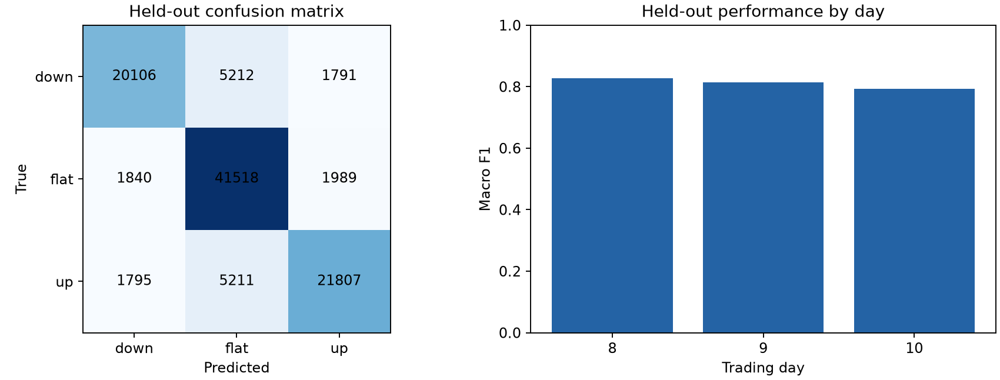

# Results

Input SHA-256: `abcf332e6e6c8eb1b29494ff93081204e289ad7592af4e6bed11dd3085247403`

| Model | Validation macro F1 |
|---|---:|
| majority | 0.183 |
| logistic | 0.742 |
| hist_gradient_boosting | 0.763 |

Selected model: **hist_gradient_boosting** (chosen on day 7 only).

| Held-out days 8–10 | Value |
|---|---:|
| Macro F1 | 0.815 |
| Balanced accuracy | 0.805 |
| Multiclass log loss | 0.531 |
| Samples | 101,269 |

These are historical classification results, not a trading backtest or evidence of profitability.
The normalized/derived FI-2010 benchmark has no executable bid/ask timestamps, queue position,
fees, slippage, or market impact in this project. See [limitations](../docs/LIMITATIONS.md).
